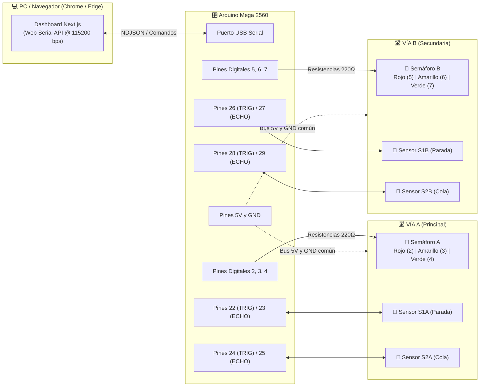

# Matriz de Conexiones — Intersección Inteligente Adaptativa (Arduino Mega 2560)

Este documento detalla todas las conexiones físicas necesarias entre el **Arduino Mega 2560**, los **semáforos LED (Vía A y Vía B)**, los **4 sensores ultrasónicos HC-SR04** y la **computadora (Dashboard Web)**, de acuerdo con el código fuente en [`interseccion_inteligente.ino`](./arduino/interseccion_inteligente/interseccion_inteligente.ino).

---

## 1. Resumen General de Componentes

| Cantidad | Componente | Función en la Maqueta |
| :---: | :--- | :--- |
| **1** | Arduino Mega 2560 | Controlador principal y telemetría por USB Serial (`115200 baudios`) |
| **2** | Semáforos de 3 LEDs (Rojo, Amarillo, Verde) | Señalización luminosa para **Vía A** (Principal) y **Vía B** (Secundaria) |
| **6** | Resistencias de $220\,\Omega$ a $330\,\Omega$ | Protección de corriente para cada uno de los 6 LEDs |
| **4** | Sensores Ultrasónicos **HC-SR04** | Detección de vehículos en línea de parada (`S1`) y cola/aproximación (`S2`) |
| **1** | Protoboard / Placa de distribución | Distribución común de alimentación **`5V`** y tierra **`GND`** |

---

## 2. Matriz de Conexiones: Semáforos LED (Pines Digitales PWM/Salidas)

Cada pin digital del Arduino se conecta al **Ánodo (+)** del LED correspondiente a través de una resistencia de **$220\,\Omega$**. Todos los **Cátodos (-)** van conectados al bus común de **`GND`**.

| Semáforo / Vía | Color del LED | Constante en Código | Pin Arduino Mega | Conexión intermedia | Retorno (Cátodo `-`) |
| :--- | :--- | :--- | :---: | :--- | :---: |
| **Semáforo Vía A** | 🔴 Rojo | `PIN_A_ROJO` | **Pin Digital `2`** | Resistencia $220\,\Omega$ en serie | `GND` común |
| **Semáforo Vía A** | 🟡 Amarillo | `PIN_A_AMARILLO` | **Pin Digital `3`** | Resistencia $220\,\Omega$ en serie | `GND` común |
| **Semáforo Vía A** | 🟢 Verde | `PIN_A_VERDE` | **Pin Digital `4`** | Resistencia $220\,\Omega$ en serie | `GND` común |
| **Semáforo Vía B** | 🔴 Rojo | `PIN_B_ROJO` | **Pin Digital `5`** | Resistencia $220\,\Omega$ en serie | `GND` común |
| **Semáforo Vía B** | 🟡 Amarillo | `PIN_B_AMARILLO` | **Pin Digital `6`** | Resistencia $220\,\Omega$ en serie | `GND` común |
| **Semáforo Vía B** | 🟢 Verde | `PIN_B_VERDE` | **Pin Digital `7`** | Resistencia $220\,\Omega$ en serie | `GND` común |

---

## 3. Matriz de Conexiones: Sensores Ultrasónicos HC-SR04

Los 4 sensores ultrasónicos se conectan al cabezal digital doble del **Arduino Mega 2560** (Pines **22 al 29**).

| Sensor | Ubicación Física en Maqueta | Pin del Sensor (HC-SR04) | Constante en Código | Pin Arduino Mega | Tipo de Señal |
| :--- | :--- | :---: | :--- | :---: | :--- |
| **Sensor `S1A`** | **Vía A — Línea de Parada** *(Debajo del semáforo A)* | `VCC` | — | **`5V`** (Bus común) | Alimentación $+5\text{V}$ |
| | | `TRIG` | `S1A_TRIG` | **Pin Digital `22`** | `OUTPUT` (Disparo ultrasónico) |
| | | `ECHO` | `S1A_ECHO` | **Pin Digital `23`** | `INPUT` (Recepción de eco) |
| | | `GND` | — | **`GND`** (Bus común) | Tierra común |
| **Sensor `S2A`** | **Vía A — Cola / Aproximación** *(Final de la Vía A)* | `VCC` | — | **`5V`** (Bus común) | Alimentación $+5\text{V}$ |
| | | `TRIG` | `S2A_TRIG` | **Pin Digital `24`** | `OUTPUT` (Disparo ultrasónico) |
| | | `ECHO` | `S2A_ECHO` | **Pin Digital `25`** | `INPUT` (Recepción de eco) |
| | | `GND` | — | **`GND`** (Bus común) | Tierra común |
| **Sensor `S1B`** | **Vía B — Línea de Parada** *(Debajo del semáforo B)* | `VCC` | — | **`5V`** (Bus común) | Alimentación $+5\text{V}$ |
| | | `TRIG` | `S1B_TRIG` | **Pin Digital `26`** | `OUTPUT` (Disparo ultrasónico) |
| | | `ECHO` | `S1B_ECHO` | **Pin Digital `27`** | `INPUT` (Recepción de eco) |
| | | `GND` | — | **`GND`** (Bus común) | Tierra común |
| **Sensor `S2B`** | **Vía B — Cola / Aproximación** *(Final de la Vía B)* | `VCC` | — | **`5V`** (Bus común) | Alimentación $+5\text{V}$ |
| | | `TRIG` | `S2B_TRIG` | **Pin Digital `28`** | `OUTPUT` (Disparo ultrasónico) |
| | | `ECHO` | `S2B_ECHO` | **Pin Digital `29`** | `INPUT` (Recepción de eco) |
| | | `GND` | — | **`GND`** (Bus común) | Tierra común |

---

## 4. Alimentación y Comunicación Serial

| Origen (Arduino Mega 2560) | Destino | Descripción |
| :--- | :--- | :--- |
| **Pin `5V`** | Riel positivo (`+`) de la Protoboard | Alimenta el pin `VCC` de los 4 sensores HC-SR04 |
| **Pin `GND`** | Riel negativo (`-`) de la Protoboard | Tierra común para los 4 sensores HC-SR04 y los 6 LEDs de los semáforos |
| **Puerto USB Tipo B** | Puerto USB de la PC (Dashboard Web) | Alimentación general y comunicación bidireccional **Web Serial API a `115200 baudios`** |

---

## 5. Diagrama Esquemático de Bloques

---

## 6. Lista de Verificación Rápida antes de Energizar

1. **Tierra Común (`GND`):** Verifica que los 6 cátodos de los LEDs y los 4 pines `GND` de los sensores HC-SR04 estén unidos al mismo riel `GND` del Arduino Mega.
2. **Orden de Pines Pares/Impares en el Mega (22 al 29):**
   - Los pines **pares (`22, 24, 26, 28`)** siempre van conectados a **`TRIG`**.
   - Los pines **impares (`23, 25, 27, 29`)** siempre van conectados a **`ECHO`**.
3. **Orientación Física de Sensores:** Asegúrate de que `S1A` y `S2A` no apunten directamente frente a `S1B` o `S2B` para evitar rebotes ultrasónicos cruzados (aunque el firmware ya incluye una pausa acústica secuencial de `25 ms` entre lecturas).
4. **Velocidad del Puerto Serial:** Tanto en el Monitor Serial como en el Dashboard Web, el selector debe estar en **`115200 baudios`**.
